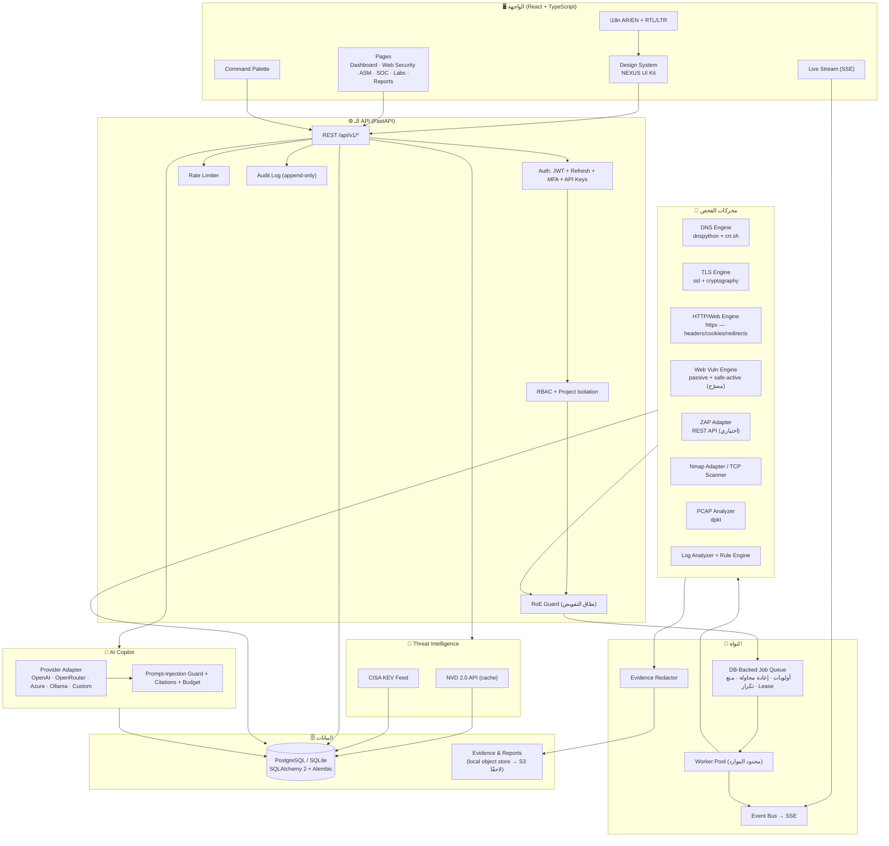
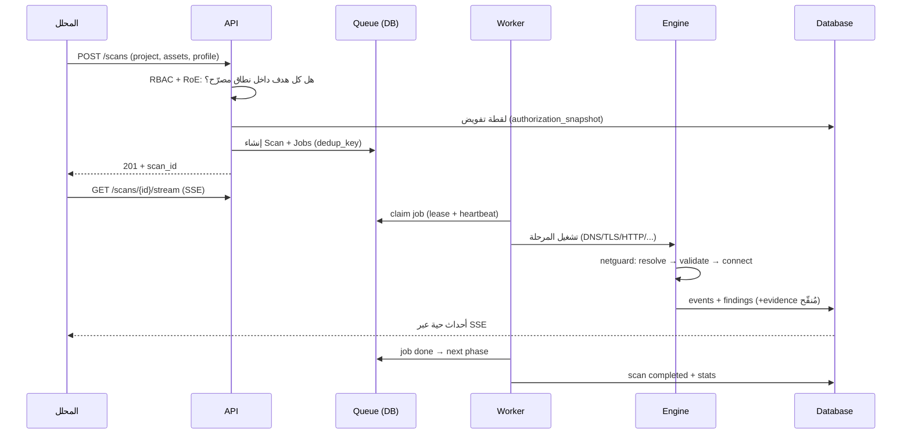

# NEXUS CYBER DEFENSE — المعمارية

> منصة دفاع سيبراني متكاملة: Web Application Security Testing · Penetration Testing Labs · Threat Intelligence · AI Security Copilot · Network Analysis · Security Operations.

## 1. المبادئ المعمارية

1. **لا نتيجة بلا مصدر**: كل سجل في قاعدة البيانات يحمل `source` و`engine_version` و`scan_id` وزمن الاكتشاف.
2. **الأمان أولًا**: كل اتصال خارجي يمر عبر حاجز واحد (`netguard`) يفرض نطاق التفويض (RoE) ويمنع SSRF والشبكات الخاصة و Cloud Metadata.
3. **العزل**: محركات الفحص لا تعمل بصلاحيات الخادم أبدًا؛ تُنفَّذ كمهام محدودة الوقت والموارد مع سياسة خروج شبكي.
4. **لا وهم**: عند غياب مكوّن (ZAP، nmap، مزوّد AI) تظهر حالته صريحة "غير مهيّأ" مع بديل حقيقي، ولا تُعرض بيانات مُلفَّقة كأنها نتائج.
5. **قابلية التتبع**: سجل تدقيق Append-Only، وكل تغيير في حالة ثغرة أو نطاق مُسجَّل بهوية الفاعل والوقت.

## 2. مخطط المكونات

## 3. مسار طلب فحص نموذجي

## 4. نموذج البيانات (الملخص)

| المجموعة | الجداول |
|---|---|
| الهوية والصلاحيات | `users`, `api_keys`, `projects`, `project_members`, `scopes` (RoE), `audit_log` |
| الأصول | `assets`, `services`, `asset_changes` |
| الفحص | `scans`, `jobs`, `events`, `findings`, `finding_events`, `evidence` |
| الاستخبارات | `cve_records`, `kev_entries`, `finding_intel_links` |
| العمليات (SOC) | `log_sources`, `log_events`, `detection_rules`, `alerts`, `incidents`, `incident_events` |
| التدريب | `labs`, `lab_runs`, `achievements` |
| التقارير | `reports` |
| النظام | `settings_kv` |

التفاصيل الكاملة: `docs/05-DATA-MODEL.md` (يُولَّد من `backend/app/models/`).

## 5. البيئات

| البيئة | قاعدة البيانات | العامل | المحركات | ملاحظات |
|---|---|---|---|---|
| **dev-lite** (الوضع الحالي لديك — Windows 10) | SQLite (WAL) | داخل عملية API | DNS/TLS/HTTP/WebVuln/TCP-Scanner/PCAP/Logs (Python خالص) | بلا Docker، بلا صلاحيات مدير؛ Nmap اختياري |
| **dev-docker** | PostgreSQL 16 | عامل مستقل | + nmap داخل الصورة، + ZAP اختياري | `docker-compose.yml` |
| **production** | PostgreSQL 16 (Managed) | N Workers | عوامل معزولة + ZAP + nmap بصلاحيات شبكية محدودة | راجع `docs/03-OPERATIONS.md` |

## 6. حدود معروفة (بصراحة)

- في dev-lite: عامل واحد داخل العملية، لذا الفحوصات المتزامنة محدودة (`NEXUS_MAX_CONCURRENT_SCANS`).
- الفحص النشط (Active) يحتاج تفعيلًا مزدوجًا: على مستوى المنصة + على مستوى النطاق المصرّح + ملف الفحص.
- ZAP غير مهيّأ لديك → تعمل المحركات الداخلية الحقيقية، وتظهر حالة التكامل بوضوح في صفحة `System`.
- nmap غير مثبّت محليًا → يعمل ماسح TCP الداخلي دائمًا؛ صورة Docker تتضمن nmap.
- محرك PCAP يدعم pcap/pcapng شائع الاستخدام؛ بعض الصيغ النادرة قد تُرفض برسالة واضحة بدل فشل صامت.
- بيانات العرض الحالية مولّدة من المحركات نفسها: 7 فحوصات، 18 نتيجة، 10 أصول، 4 خدمات، 4 تنبيهات، 23 حدثًا، 1754 إدخال KEV، 8 سجلات NVD.
